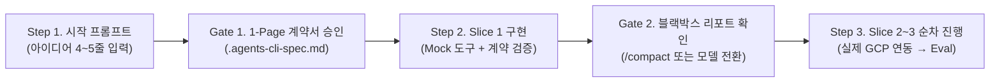

# Lean Agent Architect Kit (아키텍트·SRE를 위한 저토큰·고품질 에이전트 개발 키트)

25년 차 Java·아키텍트·SRE의 강점(**경계 설정, 입출력 계약, 장애 격리, 블랙박스 검증**)을 그대로 살려, 최신 Python/ADK 문법을 몰라도 **토큰 소모를 60~80% 줄이면서 Slop 없는 에이전트**를 만드는 실전 프레임워크입니다.

> **이미 글로벌 스킬(`~/.gemini/config/skills/lean-agent-architect`)이 설치되어 있습니다.**  
> 앞으로 **어느 폴더에서 새 프로젝트를 열든** Antigravity가 이 워크플로우를 자동으로 인식합니다.

---

## 1. 당장 다음 프로젝트부터 따라 하는 4단계 루틴 (5분 퀵스타트)

새 폴더(예: `mkdir ~/Documents/my-sre-agent`)를 열고 아래 **4단계**만 반복하시면 됩니다.



### Step 1. 새 폴더에서 '복붙용 시작 프롬프트' 입력 (모델: **Pro / Carbon** 권장)
빈 폴더에서 대화를 열고 아래 5줄만 복사해 내용만 바꿔 입력합니다:

```text
lean-agent-architect 스킬로 새 ADK 에이전트 프로젝트를 초기화하고 Gate 1 계약서를 작성해줘.
- 목적: [예: Cloud Run 에러 급증 시 최근 로그와 배포 변경점을 비교해 원인 후보 3개를 요약]
- 제외 범위(Non-Goal): [예: 롤백/재시작 등 변경(Write) 작업은 절대 하지 않음, UI 없음]
- 입출력: [예: 서비스명·조회분수 입력 → 원인 요약·근거 로그·확인 명령어 출력]
- 안전 제약: [예: 읽기 전용 API만 허용, 24시간 초과 로그 조회 차단]
```

### Step 2. Gate 1 — `.agents-cli-spec.md` 1-Page 계약서 검토 및 승인
- Antigravity가 자동으로 `GEMINI.md`, `.agents-cli-spec.md`, `STATE.md`를 생성하고, 요구사항을 **ADK 아키텍처 패턴**(단일 에이전트, 파이프라인, Scatter-Gather 등)으로 번역해 보여줍니다.
- 빈틈이 있으면 AI가 2~3개만 질문합니다. 작성된 **1-Page 계약서와 3단계 슬라이스 계획**이 의도와 맞으면 `"승인해. Slice 1만 진행해줘"`라고 답합니다.

### Step 3. Slice 1 구현 & 블랙박스 리포트 확인 (모델: **Flash** 전환 가능)
- AI가 외부 GCP 인증/권한 문제에 발목 잡히지 않도록 **Mock/Stub 도구 + 입출력 계약 테스트(`pytest`) + 로컬 스모크 실행(`agents-cli run`)**까지만 먼저 구현합니다.
- Python 코드를 일일이 읽을 필요 없이, AI가 출력하는 **블랙박스 검증 리포트**(계약 통과 여부, 스모크 입출력 결과)만 확인합니다.

### Step 4. 슬라이스 경계 리셋 후 Slice 2 → Slice 3 진행
- 슬라이스 하나가 끝날 때마다 AI가 `STATE.md`에 진행 상태를 저장합니다.
- **토큰 절약 핵심 습관**: 슬라이스가 끝날 때마다 채팅창에 **`/compact`**를 입력하거나 **새 대화창(New Conversation)**을 열고 `"@STATE.md 읽고 다음 슬라이스 진행해줘"`라고만 입력하세요. 누적 컨텍스트 비용이 즉시 초기화됩니다.

---

## 2. 상황별 Antigravity 슬래시 커맨드 & 모델 선택 치트시트

| 상황 | 할 일 (조작법) | 추천 모델 | 이유 |
| :--- | :--- | :--- | :--- |
| **아이디어가 아직 막연할 때** | `/grill-me` 입력 후 아이디어 설명 | **Pro / Carbon** | 코딩 전에 아키텍처 의사결정 트리를 하나씩 확정해 재작업 방지 |
| **스펙 승인 완료 → Slice 1~2 코딩** | `"Slice 1 진행해줘"` | **Flash** (또는 Medium) | 이미 계약서(`.agents-cli-spec.md`)에 입출력·패턴이 고정되어 빠르고 저렴함 |
| **슬라이스 1개 완료 직후** | `/compact` 또는 **새 대화창** 오픈 | 유지 | 이전 시행착오 로그가 다음 턴마다 반복 과금되는 현상 차단 |
| **동일 에러 2회 발생 (서킷 브레이커 발동)** | AI가 내놓은 5줄 원인 분석 확인 후 `/boost` 또는 A/B 선택 | **Pro / Carbon** | 무지성 코드 수정 루프를 끊고 심층 추론으로 단번에 원인 해결 |

### `/teamwork` · `owl`(`/boost` · `/goal`) 액션과 함께 쓰는 황금 패턴

이 키트의 규칙(`GEMINI.md`)과 계약서(`.agents-cli-spec.md`), 상태 파일(`STATE.md`)은 Antigravity의 고급 멀티에이전트 액션들과 **100% 호환**됩니다. 다만 토큰 폭발을 막기 위해 **투입 타이밍**을 아래처럼 구분하세요.

1. **`/teamwork` (Swarm 멀티에이전트 협업 — Quota Heavy 주의)**
   - **피해야 할 패턴**: 스펙 없이 처음부터 `/teamwork`를 실행하면 여러 워커가 동시에 Slop을 찍어내며 토큰이 수배로 소모됩니다.
   - **권장 결합 패턴**: **Gate 1(계약서)과 Slice 1(기본 골격)**은 단일 대화로 먼저 끝낸 뒤, **Slice 2에서 서로 독립된 파일 3~5개(예: 도구 모듈 4개)를 동시에 개발할 때만** 실행하세요.
   - 프롬프트 예시: `/teamwork @.agents-cli-spec.md 의 계약을 준수하여 로그·메트릭·배포 조회 도구 3개를 파일 충돌 없이 워커별로 병렬 구현하고 계약 테스트를 통과시켜줘`
2. **`owl` 계열 액션 (`/boost` 심층 추론 · 커스텀 `/owl` · `/goal` 자율 주행)**
   - **`/boost` (내부 OWL 엔진 기반 심층 조사·검증)**: 평소 구현에는 과하지만, **2-Strike 서킷 브레이커가 발동했을 때**(복잡한 비동기 버그, ADK 콜백/인증 충돌) `/boost`로 전환하면 재시도 루프 없이 한 번에 원인을 잡아내 오히려 토큰을 아껴줍니다.
   - **`/goal` (목표 달성까지 무정지 자율 주행)**: 반드시 **Gate 1 계약서(`.agents-cli-spec.md`)와 `GEMINI.md`를 먼저 생성·승인한 뒤** 실행하세요(`예: /goal .agents-cli-spec.md의 Slice 1~2를 계약 pytest 통과까지 완주해줘`). 계약서가 가드레일 역할을 해 밤새 엉뚱한 코드를 짜는 참사를 막아줍니다.

---

## 3. 다른 노트북 · 다른 계정의 Antigravity에 배포하는 4가지 방법

Antigravity의 로컬 설정(`~/.gemini/config/`)은 로그인된 Google 계정과 무관하게 **각 노트북의 로컬 디스크**에서 로드됩니다. 즉, **다른 노트북에 다른 Google 계정으로 로그인한 Antigravity**라도 파일만 배치하면 100% 동일하게 동작합니다.

상황에 따라 아래 **4가지 배포 방식** 중 가장 편한 방법을 선택하세요.

### 방법 1. GitHub Private 저장소로 배포 & 동기화 (가장 추천)
여러 대의 노트북에서 규칙을 똑같이 유지하고 업데이트할 때 가장 깔끔한 표준 방식입니다.

1. **새 노트북에서 클론 받기**
   - *다른 노트북이 다른 GitHub 계정을 쓰는 경우*: GitHub 저장소의 `Settings → Collaborators`에서 서브 계정을 초대하거나, 읽기 권한(`Contents: Read-only`)만 부여한 Fine-grained Personal Access Token(PAT)을 사용하세요.
   ```bash
   git clone https://github.com/<내-계정>/agent-design-pattern.git
   cd agent-design-pattern
   ```
2. **원클릭 글로벌 설치 실행**
   ```bash
   # macOS / Linux (글로벌 스킬로 설치)
   ./install.sh

   # Windows PowerShell
   .\install.ps1
   ```
3. **향후 규칙/템플릿 수정 시 동기화 (1초 업데이트)**
   ```bash
   cd ~/Documents/agent-design-pattern && git pull && ./install.sh
   ```

### 방법 2. Antigravity UI 플러그인 형태로 배포 (사이드바 ON/OFF 관리용)
스킬이 아니라 Antigravity 왼쪽 사이드바의 **Skills & Customizations** 화면에 카드 형태로 띄워놓고 스위치로 켜고 끄고 싶을 때 사용합니다.
```bash
./install.sh --plugin
```
- 실행 즉시 `~/.gemini/config/plugins/lean-agent-architect/`에 매니페스트(`plugin.json`)와 추천 시작 프롬프트 3종이 함께 설치되며, 재시작 없이 다음 턴부터 바로 적용됩니다.

### 방법 3. 무설치(Zero-Install) 워크스페이스 내장 배포
새 노트북의 글로벌 환경(`~/.gemini/config/`)을 전혀 건드리고 싶지 않거나 팀원에게 특정 프로젝트만 넘길 때 사용합니다.
- 개발 중인 에이전트 프로젝트 루트에 이 저장소의 **`.agents/skills/lean-agent-architect` 폴더**와 **`starter-kit/GEMINI.md`** 두 개만 복사해 Git에 함께 커밋합니다.
- 다른 노트북(다른 계정)에서 해당 프로젝트 폴더를 Antigravity로 열기만 하면 **설치 스크립트 실행 없이 자동으로 스킬과 규칙이 활성화**됩니다.

### 방법 4. 오프라인 / 보안망 노트북 배포 (ZIP · AirDrop · Google Drive)
GitHub 접속이 제한된 사내망/보안 노트북에 배포할 때 사용합니다.
1. 이 폴더 전체를 `.zip`으로 압축해 새 노트북으로 옮긴 뒤 압축을 풉니다(숨김 폴더인 `.agents/`가 포함되도록 폴더째 압축).
2. 압축 푼 폴더에서 `./install.sh` (Windows는 `.\install.ps1`)를 실행합니다.

### [체크리스트] 새 노트북에서 ADK 개발까지 하려면? (최초 1회)
이 스킬 자체는 순수 마크다운/셸 스크립트라 아무 의존성 없이 즉시 작동하지만, 실제 **Google ADK(`agents-cli`) 스캐폴딩·로컬 실행**까지 새 노트북에서 수행하려면 아래 도구를 1회 설치해 주세요:
```bash
# 1) uv (Python 패키지 매니저) 미설치 시
curl -LsSf https://astral.sh/uv/install.sh | sh

# 2) Google ADK CLI 및 기본 ADK 레퍼런스 스킬 설치
uv tool install google-agents-cli
agents-cli setup --skip-auth
```

---

## 4. 이 저장소의 구성 파일 안내

| 파일 / 폴더 | 설명 |
| :--- | :--- |
| [01-architect-to-adk-patterns.md](docs/01-architect-to-adk-patterns.md) | **Java·MSA·SRE 개념으로 이해하는 Google ADK 디자인 패턴 6선** 및 단골 함정(Gotchas) 5가지 |
| [02-token-slop-sre-playbook.md](docs/02-token-slop-sre-playbook.md) | **왜 토큰이 폭발했는가?** 원인 분석과 SRE 방식의 4중 토큰 방어막 상세 해설 |
| [starter-kit/](starter-kit/) | 새 프로젝트 생성 시 자동 복사되는 3종 원본 파일 ([GEMINI.md](starter-kit/GEMINI.md), [.agents-cli-spec.md](starter-kit/.agents-cli-spec.md), [STATE.md](starter-kit/STATE.md)) |
| [examples/gcp-sre-incident-triage/](examples/gcp-sre-incident-triage/) | **실전 완성 예제**: GCP 장애 트리아지 에이전트의 [Before/After 프롬프트](examples/gcp-sre-incident-triage/00-prompt-before-after.md), [완성된 1-Page 계약서](examples/gcp-sre-incident-triage/.agents-cli-spec.md), [슬라이스 인계 STATE 샘플](examples/gcp-sre-incident-triage/STATE.md) |

### 터미널에서 수동으로 새 프로젝트 초기화하고 싶을 때
대화로 요청하지 않고 터미널에서 직접 템플릿 3종만 먼저 깔고 싶다면 언제든 아래 명령 한 줄이면 됩니다:
```bash
bash ~/.gemini/config/skills/lean-agent-architect/scripts/init_lean_agent.sh /경로/새프로젝트폴더
```
