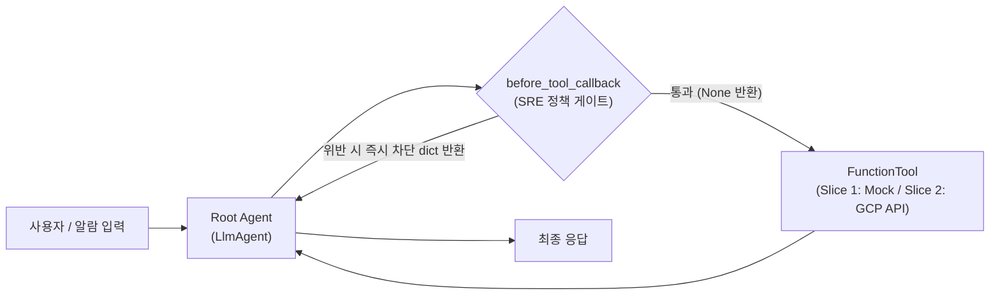
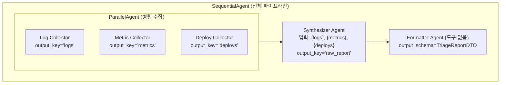
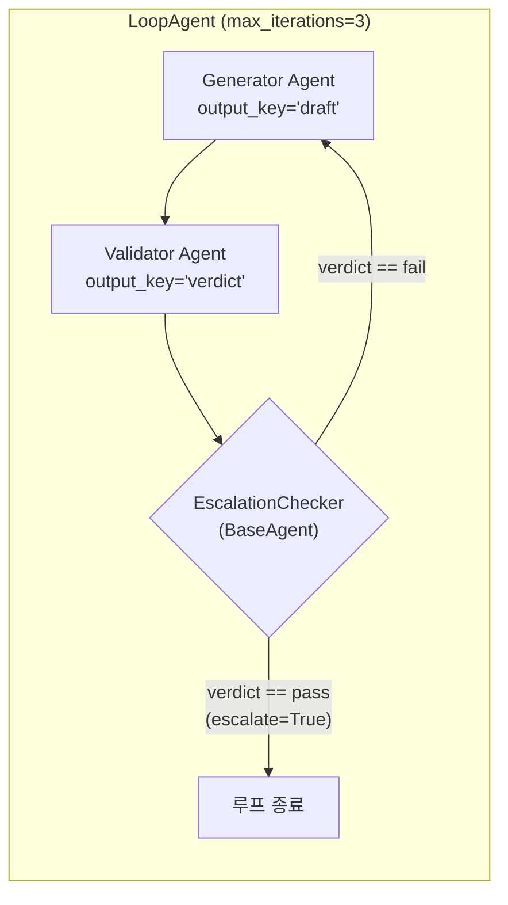

# Java·아키텍트·SRE를 위한 Google ADK 에이전트 디자인 패턴 매핑 가이드

최신 에이전트 프레임워크(Google ADK, LangGraph 등)의 용어는 생소해 보이지만, **내부 구조는 지난 20년간 엔터프라이즈 Java·MSA·분산 시스템에서 검증된 아키텍처 패턴과 1:1로 대응**됩니다.

프롬프트를 작성하거나 계약서(`.agents-cli-spec.md`)를 검토하실 때 아래 **익숙한 엔터프라이즈 개념**으로 생각하시면 됩니다.

---

## 1. 엔터프라이즈 아키텍처 ↔ ADK 패턴 1:1 매핑표

| 익숙한 Java / MSA / SRE 개념 | Google ADK 패턴 | 언제 선택하는가? (선정 기준) | Slop 방지 설계 포인트 |
| :--- | :--- | :--- | :--- |
| **단일 서비스 + DAO/Adapter** | **Single `Agent` + `FunctionTool`** | **전체 요구사항의 80%.** 도구가 5개 이하이고 한 가지 도메인 목적을 수행할 때. | 처음부터 멀티에이전트로 쪼개지 말 것! 단일 에이전트로 시작하는 것이 토큰·지연시간 모두 최소. |
| **Unix Pipe / Servlet Filter Chain** | **`SequentialAgent` (파이프라인)** | `데이터 수집 → 원인 분석 → JSON/보고서 포맷팅`처럼 **순서가 고정된 워크플로우**. | LLM에게 순서를 맡기지 않고 코드로 순서를 강제. 앞 단계의 `output_key`를 뒷 단계 프롬프트 `{key}`로 전달. |
| **Scatter-Gather / `ForkJoinPool`** | **`ParallelAgent` + Merger** | 로그 조회, 메트릭 조회, 배포 이력 조회처럼 **서로 독립적인 Read 작업을 동시에 호출**해 응답 시간을 줄일 때. | 각 병렬 에이전트는 반드시 **서로 다른 `output_key`**에 기록해야 상태 덮어쓰기(Race Condition)가 안 남. |
| **K8s Reconciler / 품질 재시도 루프** | **`LoopAgent` (제어 루프)** | `초안 생성 → 검증기(Evaluator) 심사 → 미달 시 재작성`처럼 합격 기준 통과가 중요할 때. | 반드시 `max_iterations=3` 이하로 상한선(Circuit Limit)을 걸고, 합격 시 `escalate=True`로 즉시 탈출. |
| **L7 API Gateway (라우팅 후 위임)** | **Coordinator `sub_agents`** | 고객 상담/통합 포털처럼 질문 의도에 따라 **담당 전문 에이전트에게 대화 주도권을 완전히 넘길 때**. | 각 하위 에이전트의 `description`이 곧 라우팅 테이블이므로 역할 경계를 겹치지 않게 명시. |
| **동기식 RPC 호출 / 서브루틴** | **`AgentTool` 또는 `mode="task"`** | 메인 에이전트가 **주도권을 쥔 채** 특정 분석 작업만 전문가 에이전트에게 시키고 결과 DTO만 돌려받을 때. | ADK 2.0의 `mode="task"` + `output_schema`를 쓰면 Java 인터페이스처럼 타입이 보장된 응답을 받음. |
| **Spring AOP / Envoy Filter** | **`before_tool_callback` / `BasePlugin`** | 위험 명령어 차단, 파라미터 범위 검증, 감사 로깅, PII 마스킹 등 **100% 보장되어야 하는 SRE 정책**. | 프롬프트에 *"절대 삭제하지 마"*라고 쓰는 것(확률적) 대신 **콜백 함수에서 코드로 차단(결정론적)**할 것! |

---

## 2. 실전에서 가장 많이 쓰는 3대 핵심 아키텍처 도해

### 패턴 A: Stub-First 단일 에이전트 + AOP 가드레일 (가장 권장하는 출발점)
Java에서 `Service`를 짤 때 DB부터 연결하지 않고 `Repository Stub`으로 비즈니스 로직을 먼저 검증하듯, **Slice 1에서는 `USE_MOCK_TOOLS=true` 스텁으로 에이전트 배선을 먼저 끝냅니다.**

### 패턴 B: Scatter-Gather + 정형 포맷터 (`ParallelAgent` + `SequentialAgent`)
SRE 장애 트리아지, 클라우드 비용 감사, 보안 점검처럼 **여러 소스를 병렬 수집한 뒤 정형 보고서(DTO)로 묶는 표준 패턴**입니다.

### 패턴 C: 생성-검증 제어 루프 (`LoopAgent`)
SQL 쿼리 생성, Terraform 코드 생성처럼 문법/정책 검증이 필수인 작업에 사용합니다.

---

## 3. 최신 Python/ADK를 모를 때 AI가 가장 많이 빠지는 5대 함정 (Slop 유발자)

이 키트의 `lean-agent-architect` 스킬에는 아래 5가지 함정을 사전에 회피하도록 내장되어 있습니다. 알아두시면 계약서 검토 시 훨씬 명확하게 보입니다.

1. **`output_schema`와 `tools` 동시 사용 금지 함정**
   - ADK의 일반 `Agent`에 Pydantic `output_schema`(정형 JSON 강제)를 넣으면 **도구(`tools`) 호출 기능이 자동으로 꺼집니다.**
   - **해결**: 위 *패턴 B*처럼 도구를 쓰는 에이전트 뒤에 **도구가 없는 전용 Formatter 에이전트**를 `SequentialAgent`의 마지막 단에 붙이거나 `mode="task"`를 써야 합니다. (이를 모르면 AI가 수만 토큰을 쓰며 디버깅 루프에 빠집니다.)
2. **`App(name="...")` 디렉터리 이름 불일치 에러**
   - `App(name="app", ...)`의 이름은 반드시 폴더명(`app`)과 일치해야 합니다. 마음대로 `App(name="my_sre_agent")`로 바꾸면 나중에 `agents-cli eval` 실행 시 세션을 못 찾아 실패합니다.
3. **프롬프트에만 안전 수칙을 적는 실수 (SRE 관점)**
   - *"절대 프로덕션 리소스를 삭제하지 마"*를 프롬프트에만 적으면 환각 발생 시 뚫릴 수 있습니다. 쓰기 제한이나 조회 기간 상한선은 반드시 `before_tool_callback` 파이썬 조건문으로 막아야 합니다.
4. **LLM의 자연어 답변을 `pytest`로 검사하는 실수**
   - AI에게 그냥 "테스트 짜줘"라고 하면 LLM 응답 문자열에 특정 단어가 있는지 `pytest`로 검사하려다 비결정성 때문에 계속 깨집니다.
   - **원칙**: `pytest`는 오직 **입출력 스키마와 가드레일 함수**만 검증하고, 에이전트 지능 평가는 `agents-cli eval`로 분리합니다.
5. **처음부터 GCP 실환경(IAM, Vertex AI, Cloud Logging)을 붙이는 실수**
   - 에이전트 프롬프트 버그인지, GCP 서비스 계정 권한(403) 문제인지 뒤엉켜 디버깅 토큰이 3~5배로 뜁니다. 항상 **Slice 1(Mock 스텁 완주) → Slice 2(실제 GCP API 교체)** 순서를 지켜야 합니다.
